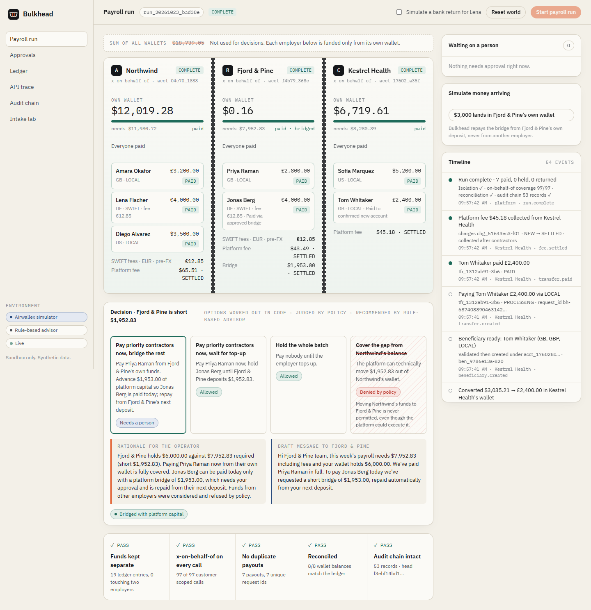

<div align="center">


# Bulkhead

**Payroll for many employers. Money that never mixes.**

An agent that runs weekly contractor payroll across Airwallex connected accounts.<br />
It prices, converts and pays each employer only from that employer's own wallet. When an employer is short,<br />
it works out what to do instead of borrowing someone else's money.

Airwallex Agentic Banking Hackathon 2026 · **Track 6: Multi-Employer Payroll Executor** · Multi-Tenant Platforms

</div>

---

## Table of contents

1. [Overview](#overview)
2. [Why "Bulkhead"](#why-bulkhead)
3. [The problem Track 6 sets](#the-problem-track-6-sets)
4. [What Bulkhead does](#what-bulkhead-does)
5. [A run, step by step](#a-run-step-by-step)
6. [How Bulkhead meets Track 6](#how-bulkhead-meets-track-6)
   - [The required flow](#the-required-flow)
   - [Every warning in the brief](#every-warning-in-the-brief)
7. [What the judges are looking for, and how Bulkhead meets it](#what-the-judges-are-looking-for-and-how-bulkhead-meets-it)
8. [Architecture](#architecture)
9. [The shortfall decision in detail](#the-shortfall-decision-in-detail)
10. [Safety and security](#safety-and-security)
11. [Quick start](#quick-start)
12. [Configuration](#configuration)
13. [Testing and quality](#testing-and-quality)
14. [Project structure](#project-structure)
15. [Limits](#limits)
16. [Roadmap](#roadmap)
17. [Documentation](#documentation)
18. [License](#license)

---

## Overview

Bulkhead is a payroll platform for companies with international contractors. On Airwallex, each employer is a **connected account** with its own wallet. The platform can see every wallet and can technically move money between them. That power is exactly what makes multi-employer payroll dangerous.

Bulkhead runs a weekly payroll for several employers at once and guarantees, in code, that each employer's contractors are paid only from that employer's money. It reads messy payroll instructions, prices every payout including SWIFT fees, converts currency inside the right wallet, pays contractors, collects the platform's fee, and when an employer is short it lays out the options, refuses the unsafe one, and asks a person to approve the right one. After every run it proves what it did.

|                             |                                                                                                                                                                                   |
| --------------------------- | --------------------------------------------------------------------------------------------------------------------------------------------------------------------------------- |
| **Track**                   | 6 · Multi-Employer Payroll Executor                                                                                                                                               |
| **Airwallex products used** | Connected accounts, Global Accounts, deposits, balances, beneficiaries, FX quotes and conversions, transfers, transfer simulation, connected-account transfers, charges, webhooks |
| **AI**                      | Claude (`claude-opus-5-5`) for reading payroll messages, recommending decisions and explaining failures; a rule-based advisor offline or as fallback                              |
| **Stack**                   | TypeScript, Node 24, Fastify, React, Vite, Vitest, Playwright, Docker                                                                                                             |
| **Runs**                    | Fully offline with a faithful sandbox simulator, or against the real Airwallex sandbox                                                                                            |

<p align="center"></p>

## Why "Bulkhead"

A **bulkhead** is a sealed wall inside a ship's hull. Ships are divided into compartments so that if one is breached, water cannot flow into the others and sink the vessel.

That is the exact property a multi-employer payroll platform needs:
- **One employer's shortfall must not spread to another.** If Fjord & Pine is short, Northwind's money must not quietly flow in to cover it, even though the platform has the access to do so.
- **One employer's deposit must not hide another's problem.** When Kestrel's money arrives, Fjord & Pine is still short, and the platform must still treat it as short.
- **Failures stay contained.** A returned payment, a changed bank account, or an unexpected API response affects one compartment and is handled there.

The name is the design. Every part of the codebase is built around the compartment: pricing only accepts one employer's balances, the API client for customer money cannot exist without an employer's account id, and the ledger refuses any entry that touches two employers. The same pattern is used in software reliability engineering (the "bulkhead pattern" isolates failures), which makes the idea familiar to engineers on day one.

## The problem Track 6 sets

The Airwallex brief for Track 6 builds in a trap. Three employers, one payroll run:

| Employer                |                           Own wallet | This week's payroll (payouts + fees) |
| ----------------------- | -----------------------------------: | -----------------------------------: |
| A · Northwind Robotics  |                              $24,000 |                           $11,980.72 |
| B · Fjord & Pine Studio |                               $6,000 |       $7,952.83, **short $1,952.83** |
| C · Kestrel Health Labs | $0, then **$15,000 arrives mid-run** |                            $8,280.39 |
| _Sum of all wallets_    |                            _$45,000_ |                 _must never be used_ |

In the brief's words: _"If the agent sums balances across tenants, it will report enough money for a batch the short employer cannot fund."_ Kestrel's deposit lands in Kestrel's wallet. Fjord & Pine's balance does not change. Fjord & Pine still cannot pay Jonas.

## What Bulkhead does

1. **Reads** each employer's instructions as they really arrive: a CSV export, an email, a Slack message. Claude extracts the payroll lines and flags anything a person must see, such as a contractor whose bank details just changed.
2. **Seals** each employer in its own compartment. Balances are read with `x-on-behalf-of: <that employer>`, and nothing in the codebase can add compartments together.
3. **Prices** payouts, SWIFT fees and the platform fee in exact integer arithmetic, adding the fees _before_ converting currency so the last payout never fails.
4. **Decides** when an employer is short. Code lists the options, policy rules on each one, and the advisor recommends one of the options it is allowed to choose. Borrowing from another employer is listed and refused.
5. **Pays** with stable request ids, follows every transfer to a final status (`PAID` or `CANCELLED`), and collects the platform fee only after contractors are paid.
6. **Proves** it: a double-entry ledger, a reconciliation against Airwallex balances, a check that every customer call carried `x-on-behalf-of`, a duplicate-payout check, and a tamper-evident audit chain.

## A run, step by step

This is the scenario in the live console and in `pnpm demo`.

| Step | What happens                                                                                                                                                                                                                            | Why it matters                                                                                               |
| ---- | --------------------------------------------------------------------------------------------------------------------------------------------------------------------------------------------------------------------------------------- | ------------------------------------------------------------------------------------------------------------ |
| 1    | Three employer connected accounts are created, submitted and activated, each with a USD Global Account. Northwind and Fjord & Pine are funded; Kestrel is not.                                                                          | Matches the brief's setup: "activate three employers, fund two".                                             |
| 2    | Bulkhead reads Northwind's CSV, Fjord & Pine's email and Kestrel's Slack message. Kestrel's message says Tom changed banks.                                                                                                             | Real payroll arrives as messy text. A bank change is a common payroll fraud pattern, so it goes to a person. |
| 3    | Each employer's wallet is read on its own. Northwind is covered. Fjord & Pine is $1,952.83 short. Kestrel has $0 and waits for its own deposit.                                                                                         | No cross-employer sums, ever.                                                                                |
| 4    | Northwind's payroll is priced with the €12.85 SWIFT fee included, converted inside Northwind's wallet, and paid.                                                                                                                        | Fees before FX; conversion confirmed in the right account.                                                   |
| 5    | For Fjord & Pine, code lists four options. Borrowing from Northwind is shown and denied by policy. The advisor recommends: pay Priya now from Fjord & Pine's own funds, and bridge $1,953 of platform capital for Jonas, with approval. | The agent changes its plan when the balance changes, and it cannot pick an unsafe option.                    |
| 6    | Kestrel's $15,000 deposit lands. Fjord & Pine is re-read on its own: unchanged, still short.                                                                                                                                            | The exact trap in the brief, handled and recorded on the timeline.                                           |
| 7    | A person approves Tom's new bank details and the $1,953 bridge. Each approval is bound by a SHA-256 hash to the exact amount, counterparty and terms.                                                                                   | People approve what they saw, and nothing else.                                                              |
| 8    | All seven contractors are paid. Platform fees are collected, each after that employer's contractors.                                                                                                                                    | Contractors first, platform second.                                                                          |
| 9    | The proof bar shows five passing checks. When Fjord & Pine later deposits its own money, the bridge is repaid from it.                                                                                                                  | Every claim is verifiable after the run.                                                                     |

## How Bulkhead meets Track 6

### The required flow

The brief lists the flow for this track. Every step is implemented:

| Brief: "The flow"                  | Bulkhead                                                                                                | Code                                                                  |
| ---------------------------------- | ------------------------------------------------------------------------------------------------------- | --------------------------------------------------------------------- |
| Activate three employers           | Create, submit (with EIN), simulate activation, confirm ACTIVE                                          | `Bulkhead.bootstrap()` in [`engine.ts`](packages/agent/src/engine.ts) |
| Fund two                           | Global Account per employer; deposits for Northwind and Fjord & Pine; Kestrel's deposit arrives mid-run | `deposit()`                                                           |
| Price each payroll including fees  | Payouts + SWIFT fees + platform fee, per employer, in bigint                                            | [`pricing.ts`](packages/core/src/pricing.ts)                          |
| Convert on behalf of each employer | Quote locked, conversion with `x-on-behalf-of`, balance re-read to confirm                              | `executeLines()`                                                      |
| Create contractor beneficiaries    | Validate, then create, per corridor (US ABA, UK sort code, DE IBAN + SWIFT)                             | `ensureBeneficiary()`                                                 |
| Pay                                | Transfer per contractor with explicit LOCAL / SWIFT method and a stable request id                      | `payLine()`                                                           |
| Handle the shortfall               | Options in code, policy judgement, advisor recommendation, approval, bridge                             | `handleShortfall()`                                                   |
| Collect fees                       | `charges/create` after contractors, polled until SETTLED                                                | `collectFee()`                                                        |

### Every warning in the brief

Each warning in the [Track 6 builder guide](https://airwallexdev.com/guide#6-multi-employer-payroll-executor) and its sandbox notes, and where Bulkhead handles it:

| The brief warns                                                                    | Bulkhead                                                                                               | Tested in                                               |
| ---------------------------------------------------------------------------------- | ------------------------------------------------------------------------------------------------------ | ------------------------------------------------------- |
| Don't use one employer's funds for another, even though the platform can           | Compartments, `TENANT_ISOLATION` deny rule, ledger rejects any two-employer entry                      | `policy.test.ts`, `integrity.test.ts`, `engine.test.ts` |
| Summing balances reports enough money for a batch the short employer can't fund    | Pricing asserts it received that employer's own compartment; no API sums compartments                  | `pricing.test.ts`                                       |
| Calculate SWIFT fees before converting                                             | Fees are part of the amount converted; policy denies conversions that leave the batch short            | `pricing.test.ts`, `policy.test.ts`                     |
| Set the transfer method explicitly                                                 | `Contractor.method` is required; never inferred from fees                                              | `pricing.test.ts`                                       |
| Send `x-on-behalf-of` on every employer FX and simulation call                     | `TenantClient` cannot be created without an `acct_` id; a recorder proves coverage on every run        | `simulator.test.ts`, run proofs                         |
| Confirm the conversion landed in the connected account                             | Employer balances re-read after every conversion                                                       | engine timeline                                         |
| Transfers created on a customer's behalf stay PROCESSING                           | Each payout moved to SENT, then PAID or FAILED, and polled to a final status                           | `simulator.test.ts`                                     |
| A failed transfer ends in CANCELLED, not FAILED                                    | CANCELLED + `failure_type` handled as a return; money returns to the right wallet; no automatic resend | `engine.test.ts`                                        |
| Activate accounts before FX; `unconfigured_client_fee` after activation            | Create, submit, activate; FX retries through that window                                               | `simulator.test.ts`                                     |
| `request_id` reuse returns `duplicate_request_id`; transfers need 10–50 characters | Deterministic 40-character ids per operation; unclear errors looked up before any retry                | `simulator.test.ts`                                     |
| Charges and platform transfers return NEW                                          | Polled until SETTLED                                                                                   | `simulator.test.ts`                                     |
| Three different insufficient-funds codes                                           | All three recognised                                                                                   | `integrity.test.ts`                                     |
| EIN required for on-behalf transfers                                               | Included when the account is created                                                                   | `simulator.test.ts`                                     |
| Webhooks: HMAC over timestamp + raw body, duplicates, out of order                 | Raw-body verification, dedupe on event id, sort by `created_at`                                        | `server.test.ts`                                        |
| Sandbox rate limits (20 rps, 10 per endpoint, 10 concurrent)                       | Client-side pacing below the limits; backoff on 429                                                    | `limiter.ts`, `paced.ts`                                |

## What the judges are looking for, and how Bulkhead meets it

The hackathon has not published a numeric scoring rubric. The criteria below come from the official sources: the [hackathon page](https://airwallex.hackerearth.com/), the [HackerEarth listing](https://www.hackerearth.com/challenges/hackathon/agentic-banking-hackathon/), and the section of the [Airwallex builder guide](https://airwallexdev.com/guide) titled _Build around a financial decision_, which describes what a strong entry should show.

### 1. Submission requirements

| Required                                                                | Bulkhead                                                                                                 |
| ----------------------------------------------------------------------- | -------------------------------------------------------------------------------------------------------- |
| A working demo                                                          | Live console (`pnpm start`), a headless run (`pnpm demo`), and a Docker image. Runs with no credentials. |
| A video walkthrough under five minutes                                  | 2:54 product film, linked in the submission                                                              |
| A repository link with setup instructions                               | This repository, [SETUP.md](SETUP.md) and the [Quick start](#quick-start) below                          |
| Submission must be functional so judges can review it (HackerEarth FAQ) | Works offline in under a minute; 63 automated tests and 2 browser tests                                  |
| Code must be open source (HackerEarth FAQ)                              | Public repository, Apache-2.0                                                                            |

### 2. The builder guide's criteria for a strong entry

| The guide asks for                                                                                                                          | How Bulkhead meets it                                                                                                                                           |
| ------------------------------------------------------------------------------------------------------------------------------------------- | --------------------------------------------------------------------------------------------------------------------------------------------------------------- |
| "Choose a finance task that someone repeats and identify the decision inside it."                                                           | Weekly multi-employer payroll; the decision is what to do when one employer can't fund its own batch.                                                           |
| "The agent should choose differently when a balance, deadline, piece of evidence, or risk changes."                                         | Shortfall changes the plan; a mid-run deposit triggers a re-check; a bank-detail change triggers review; a bank return triggers an exception path.              |
| "Let the agent move money or update financial state, and state which actions require a person's approval."                                  | It converts, pays, bridges and charges. Bridges, bank-detail changes and large fees need a person; the rules are in [`policy.ts`](packages/core/src/policy.ts). |
| "Show the user's goal, the agent's initial plan, the new information, the revised decision, and the resulting balance, payment, or status." | The console timeline shows each of these in order; the demo script follows the same arc ([docs/DEMO.md](docs/DEMO.md)).                                         |
| "Keep amounts, limits, reserves, validation, duplicate protection, and state transitions in code."                                          | All of these live in `packages/core`, which has no I/O and is fully unit tested.                                                                                |
| "Use the model to read unstructured text, compare evidence, propose a plan, and explain an exception."                                      | Exactly the three things the advisor does: intake, shortfall recommendation, exception explanation.                                                             |
| "Give the model typed tools rather than unrestricted credentials."                                                                          | The model never sees keys or calls Airwallex. It returns schema-validated JSON, and only options policy has already judged can be chosen.                       |
| "Bind each approval to the amount, currency, counterparty, purchase terms, and evidence shown to the approver."                             | `ApprovalSubject` is hashed with SHA-256; `checkBinding()` runs right before execution; any change makes the approval stale.                                    |
| "Put sandbox-only simulation calls behind one interface."                                                                                   | One `Transport` interface; the simulator and the real HTTP transport are interchangeable.                                                                       |
| "Finish the demo with a financial action or an escalation to a person."                                                                     | The run ends with payouts, a bridge, fee charges, and a bridge repayment, all recorded.                                                                         |
| "If the agent should make the same choice every time, write the rule in code."                                                              | Pricing, isolation, caps and fee rules are deterministic; the model is used only where judgement varies.                                                        |

### 3. The judging panel

Judges at Demo Day come "from fintech and venture". The questions that audience tends to ask, and the answers:

| Likely question                                | Answer                                                                                                                                                                        |
| ---------------------------------------------- | ----------------------------------------------------------------------------------------------------------------------------------------------------------------------------- |
| Would I trust this with real money?            | Isolation is enforced by construction and proven after every run; approvals are bound to exact terms; duplicate payouts are prevented by design.                              |
| Is the AI doing something real, or decorative? | The model handles the work rules can't do well (messy text, weighing options, explaining failures) and is kept away from arithmetic and credentials.                          |
| Does it understand Airwallex?                  | Every Track 6 warning is handled and tested, and the sandbox behaviours are documented in [docs/airwallex-integration.md](docs/airwallex-integration.md).                     |
| Is there a business here?                      | Payroll for international contractors is a recurring, high-trust job; platforms serving many employers face exactly this isolation problem, and Bulkhead earns a fee per run. |
| Is it built well enough to keep going?         | CI on two operating systems, a threat model, design records, and docs written for both people and coding agents.                                                              |

### 4. Prize categories

Bulkhead competes in the open categories (Founder's Choice and Judges' Choice), which have no extra requirements. It does not use Visa or Metal tooling, so it does not target those two awards.

## Architecture

```
 employer messages ──► Advisor (Claude | rules) ──► payroll lines, flags
                                                         │
                     ┌───────────── one sealed pipeline per employer ─────────────┐
                     │ TenantClient(acct_X)  ──►  Compartment(acct_X)              │
                     │        │                       │                           │
                     │        ▼                       ▼                           │
                     │   Airwallex API  ◄──  pricing (bigint)  ──►  policy.evaluate │
                     │   x-on-behalf-of        fees before FX        allow/approve/deny
                     └─────────────────────────────────────────────────────────────┘
                                                         │
                          ledger · reconciliation · header coverage · audit chain
```

**The model reads and recommends. Code moves the money.** This follows Airwallex's guidance:

> Keep amounts, limits, reserves, validation, duplicate protection, and state transitions in code. Use the model to read unstructured text, compare evidence, propose a plan, and explain an exception.

| Concern                                                                 | Where it lives                                                                 |
| ----------------------------------------------------------------------- | ------------------------------------------------------------------------------ |
| Money arithmetic (bigint minor units, round-up on conversion)           | [`packages/core/src/money.ts`](packages/core/src/money.ts)                     |
| Compartments and the breach check                                       | [`packages/core/src/compartment.ts`](packages/core/src/compartment.ts)         |
| Payroll pricing, fees before FX, rationing inside a compartment         | [`packages/core/src/pricing.ts`](packages/core/src/pricing.ts)                 |
| Policy engine (isolation, bridge caps, fraud review, FX drift)          | [`packages/core/src/policy.ts`](packages/core/src/policy.ts)                   |
| Approvals bound by SHA-256 to exact terms                               | [`packages/core/src/approvals.ts`](packages/core/src/approvals.ts)             |
| Ledger with a per-entry isolation check                                 | [`packages/core/src/ledger.ts`](packages/core/src/ledger.ts)                   |
| Hash-chained audit log                                                  | [`packages/core/src/audit.ts`](packages/core/src/audit.ts)                     |
| Typed Airwallex client; `TenantClient` always sends `x-on-behalf-of`    | [`packages/airwallex/src/clients.ts`](packages/airwallex/src/clients.ts)       |
| Sandbox simulator reproducing documented behaviour                      | [`packages/airwallex/src/simulator.ts`](packages/airwallex/src/simulator.ts)   |
| Run engine (per-employer lanes, shortfall handling, proofs)             | [`packages/agent/src/engine.ts`](packages/agent/src/engine.ts)                 |
| Claude advisor (structured output, schema-checked, falls back to rules) | [`packages/agent/src/advisor/claude.ts`](packages/agent/src/advisor/claude.ts) |

More detail: [docs/ARCHITECTURE.md](docs/ARCHITECTURE.md).

## The shortfall decision in detail

When Fjord & Pine is short, code produces four options and policy rules on each one _before_ the advisor sees them:

| Option                                                                                                                                          | Policy                                                |
| ----------------------------------------------------------------------------------------------------------------------------------------------- | ----------------------------------------------------- |
| Pay Priya now from Fjord & Pine's funds; bridge **$1,953** of _platform_ capital so Jonas is paid today; repay from Fjord & Pine's next deposit | **Needs a person** · per-employer cap · reserve floor |
| Pay Priya now; hold Jonas until Fjord & Pine tops up                                                                                            | Allowed                                               |
| Hold everyone                                                                                                                                   | Allowed                                               |
| Cover the gap from Northwind's balance                                                                                                          | **Denied** · `TENANT_ISOLATION`                       |

The advisor recommends one of the allowed options, writes the reason for the operator, and drafts a message to the employer. If it proposes a denied option, or returns anything that fails the schema, Bulkhead falls back to the rule-based advisor. The bridge is rounded up to whole dollars so cent-level FX rounding can never leave Jonas short; the extra cents stay in Fjord & Pine's wallet and are repaid with the bridge.

## Safety and security

| Risk                                                                 | Control                                                                                                      |
| -------------------------------------------------------------------- | ------------------------------------------------------------------------------------------------------------ |
| One employer's money funds another                                   | Compartments, deny rule, ledger check, isolation proof per run                                               |
| A customer call misses `x-on-behalf-of` and hits the platform wallet | `TenantClient` sets it on every call; the recorder proves coverage                                           |
| Paying a contractor twice after a timeout                            | Deterministic request ids, lookup before retry, duplicate lock                                               |
| Payroll redirection ("I changed banks")                              | Every bank-detail change needs a person                                                                      |
| Prompt injection in an employer message                              | Schema-constrained output, roster matching, amounts re-parsed by code, no tools or credentials for the model |
| Approving one thing and executing another                            | SHA-256 binding checked right before execution                                                               |
| Forged webhooks                                                      | HMAC on the raw body, timestamp tolerance, constant-time compare, dedupe                                     |
| Tampered history                                                     | Hash-chained audit log with verification in the API and UI                                                   |

Full threat model: [docs/THREAT_MODEL.md](docs/THREAT_MODEL.md). Reporting vulnerabilities: [SECURITY.md](SECURITY.md).

## Quick start

```bash
# Requirements: Node 22.13+ (24 recommended) and pnpm 10+
pnpm install
pnpm --filter @bulkhead/web build
pnpm start                 # open http://127.0.0.1:8787/console
```

Press **Start payroll run**, then approve the two cards when they appear.

```bash
pnpm demo        # the whole Track 6 scenario in the terminal, ending in a proof report
pnpm check       # lint + typecheck + tests
pnpm e2e         # Playwright: an operator runs payroll in the browser
docker compose up --build   # the same app in a container
```

Example `pnpm demo` ending (counts vary slightly between runs):

```text
Proof report
  Tenant isolation       PASS  (19 journals, 0 violations)
  x-on-behalf-of         PASS  (100 customer-scoped calls, 0 missing)
  No duplicate payouts   PASS  (7 payouts, 7 unique request ids)
  Reconciliation         PASS  (8 wallet balances match the ledger)
  Audit chain            PASS  (55 records, head 7a40ec3adf61…)
```

Full instructions, including the real Airwallex sandbox: [SETUP.md](SETUP.md).

## Configuration

With no configuration Bulkhead runs fully offline. Copy `.env.example` to `.env` to go further:

| Variable                                                               | Effect                                                                                     |
| ---------------------------------------------------------------------- | ------------------------------------------------------------------------------------------ |
| `ANTHROPIC_API_KEY`                                                    | Enables the Claude advisor (`claude-opus-5-5`)                                             |
| `AIRWALLEX_MODE=sandbox` + `AIRWALLEX_CLIENT_ID` + `AIRWALLEX_API_KEY` | Uses the real Airwallex sandbox (connected accounts and platform payments must be enabled) |
| `AIRWALLEX_EMPLOYER_ACCOUNT_IDS`                                       | Reuses three existing connected accounts                                                   |
| `AIRWALLEX_WEBHOOK_SECRET`                                             | Enables signed webhooks at `POST /webhooks/airwallex`                                      |
| `BULKHEAD_OPERATOR_TOKEN`                                              | Requires a token on every console action                                                   |
| `BULKHEAD_PACE`                                                        | Milliseconds between visible steps in the console                                          |

## Testing and quality

| Area                                       | What is checked                                                              |
| ------------------------------------------ | ---------------------------------------------------------------------------- |
| Unit tests (`packages/core`)               | Money arithmetic, pricing, every policy rule, approvals, ledger, audit chain |
| Simulator tests (`packages/airwallex`)     | Each documented sandbox behaviour, idempotent retries, webhooks, rate limits |
| End-to-end engine tests (`packages/agent`) | Full Track 6 run; rejected approvals; bank return without double payment     |
| HTTP API tests (`apps/api`)                | Health, runs over HTTP, validation, webhook signatures, intake               |
| Browser tests (`apps/web/e2e`)             | An operator runs payroll and sees five passing proofs                        |

63 automated tests and 2 browser tests. Measured line coverage is about 94% for `packages/core` and about 91% for the run engine.

Continuous integration ([`.github/workflows`](.github/workflows)) runs lint, typecheck and tests on Linux and Windows with Node 22 and 24, the headless demo, the browser tests, a Docker build with a smoke test, CodeQL, dependency review, `pnpm audit`, and secret scanning. A manual workflow runs the scenario against the real sandbox.

## Project structure

```
bulkhead/
├── apps/
│   ├── api/                      Fastify server: REST, live updates (SSE), webhooks; serves the console
│   │   ├── src/
│   │   │   ├── config.ts         Environment configuration and validation
│   │   │   ├── runtime.ts        Builds the engine; persists the audit chain
│   │   │   ├── server.ts         Routes, security headers, operator token, webhook verification
│   │   │   ├── main.ts           Server entrypoint
│   │   │   ├── demo-cli.ts       Headless run that prints the proof report (pnpm demo)
│   │   │   └── sandbox-smoke.ts  Runs the scenario against the real Airwallex sandbox
│   │   └── test/                 HTTP API tests
│   └── web/                      React console and landing page (Vite)
│       ├── src/
│       │   ├── pages/
│       │   │   ├── Landing.tsx   Landing page
│       │   │   └── console/      Run, approvals, ledger, API trace, audit chain, intake lab
│       │   ├── components/       Mark and hull diagram
│       │   ├── lib/api.ts        API client and live snapshot hook
│       │   └── styles.css        Design system
│       └── e2e/                  Playwright browser tests
├── packages/
│   ├── core/                     Pure domain logic, no I/O
│   │   ├── src/
│   │   │   ├── money.ts          Exact bigint money
│   │   │   ├── compartment.ts    Per-employer compartments
│   │   │   ├── pricing.ts        Payroll pricing, fees before FX
│   │   │   ├── policy.ts         Policy engine
│   │   │   ├── approvals.ts      SHA-256-bound approvals
│   │   │   ├── ledger.ts         Double-entry ledger with isolation check
│   │   │   ├── audit.ts          Hash-chained audit log
│   │   │   └── transfers.ts      Transfer state machine
│   │   └── test/                 Unit tests
│   ├── airwallex/                Airwallex integration
│   │   ├── src/
│   │   │   ├── clients.ts        PlatformClient and TenantClient
│   │   │   ├── http.ts           REST transport (auth, pacing, backoff)
│   │   │   ├── simulator.ts      Sandbox simulator
│   │   │   ├── recorder.ts       Call recorder and header-coverage proof
│   │   │   ├── webhooks.ts       Signature verification and dedupe
│   │   │   └── ...               Types, errors, rate limiting, bank validation
│   │   └── test/                 Simulator and client tests
│   └── agent/                    The payroll agent
│       ├── src/
│       │   ├── engine.ts         Run engine
│       │   ├── advisor/          Claude advisor and rule-based advisor
│       │   ├── scenario.ts       The three-employer demo scenario
│       │   └── state.ts          State shared with the console
│       └── test/                 End-to-end engine tests
├── docs/
│   ├── ARCHITECTURE.md           How the system fits together
│   ├── airwallex-integration.md  Endpoints, sandbox behaviour, open questions
│   ├── THREAT_MODEL.md           Threats and controls
│   ├── DEMO.md                   Three-minute live demo script
│   ├── JUDGING.md                Five-minute guide for judges
│   ├── adr/                      Architecture decision records
│   └── assets/                   Images used in the docs
├── .github/
│   ├── workflows/                CI, CodeQL, supply chain, sandbox smoke test
│   ├── ISSUE_TEMPLATE/           Bug report and feature request forms
│   ├── PULL_REQUEST_TEMPLATE.md  Includes a money-safety checklist
│   ├── CODEOWNERS
│   └── dependabot.yml
├── AGENTS.md                     Instructions for AI coding agents
├── SETUP.md                      Full setup guide
├── PLAN.md                       Plan, status and risks
├── CONTRIBUTING.md
├── CODE_OF_CONDUCT.md
├── SECURITY.md
├── PRIVACY.md
├── CHANGELOG.md
├── Dockerfile
├── docker-compose.yml
├── .env.example
└── LICENSE
```

## Limits

- **The simulator is the default.** It reproduces the sandbox behaviour documented in the builder guide (listed in [docs/airwallex-integration.md](docs/airwallex-integration.md)). The HTTP transport implements the same calls against `api.sandbox.airwallex.com`, but this repository has not yet been run against a live sandbox account with platform access enabled. Run the `sandbox-smoke` workflow once Airwallex grants access.
- **Without `ANTHROPIC_API_KEY` the advisor is rule-based.** The console always shows which advisor is active.
- **Synthetic data only.** People, companies and bank accounts are fictional. Sandbox only; no real money moves.

## Roadmap

Live sandbox verification, a recorded live-sandbox demo, real webhook subscriptions, and month-end platform reports. Details and risks are in [PLAN.md](PLAN.md).

## Documentation

| Document                                                                                                                                                             | Contents                                                                     |
| -------------------------------------------------------------------------------------------------------------------------------------------------------------------- | ---------------------------------------------------------------------------- |
| [SETUP.md](SETUP.md)                                                                                                                                                 | Local, Docker, Claude and real-sandbox setup; configuration; troubleshooting |
| [PLAN.md](PLAN.md)                                                                                                                                                   | Plan, status, risks, submission checklist                                    |
| [AGENTS.md](AGENTS.md)                                                                                                                                               | Rules and invariants for AI coding agents                                    |
| [docs/ARCHITECTURE.md](docs/ARCHITECTURE.md)                                                                                                                         | Components and a run in detail                                               |
| [docs/airwallex-integration.md](docs/airwallex-integration.md)                                                                                                       | Endpoints and sandbox behaviour                                              |
| [docs/THREAT_MODEL.md](docs/THREAT_MODEL.md)                                                                                                                         | Threats and controls                                                         |
| [docs/DEMO.md](docs/DEMO.md)                                                                                                                                         | Live demo script                                                             |
| [docs/JUDGING.md](docs/JUDGING.md)                                                                                                                                   | Guide for judges                                                             |
| [docs/adr](docs/adr)                                                                                                                                                 | Design decisions                                                             |
| [CONTRIBUTING.md](CONTRIBUTING.md) · [SECURITY.md](SECURITY.md) · [PRIVACY.md](PRIVACY.md) · [CODE_OF_CONDUCT.md](CODE_OF_CONDUCT.md) · [CHANGELOG.md](CHANGELOG.md) | Project policies                                                             |

## License

[Apache-2.0](LICENSE). Airwallex is a trademark of Airwallex US, LLC. This project is not affiliated with or endorsed by Airwallex.
